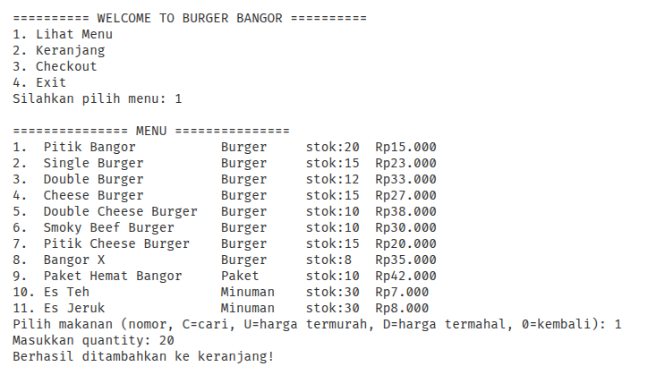
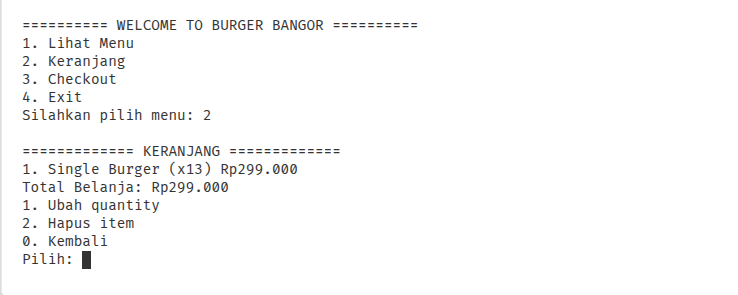
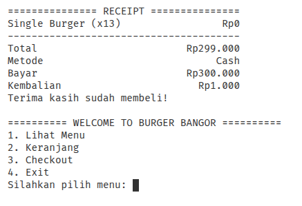

# Burger Bangor System (C# / .NET)

Aplikasi pemesanan makanan berbasis **Console** bertema **Burger Bangor** (mengacu pada project Homework 1), dibuat dengan **C# (.NET 10)** dan menerapkan konsep **Object-Oriented Programming (OOP)**.-

## Fitur

- Lihat menu (10 item dari Homework 1: Burger, Paket, Minuman) lengkap dengan harga dan stok
- Cari menu berdasarkan nama, urutkan berdasarkan harga (termurah / termahal)
- Tambah pesanan ke keranjang — produk yang sama otomatis **digabung** quantity-nya
- Ubah quantity, hapus pesanan, dan lihat total belanja
- Checkout dengan 2 metode pembayaran: **Cash** dan **QRIS**
- Validasi pembayaran sebelum transaksi dinyatakan berhasil
- Struk (receipt) setelah checkout berhasil
- Error handling: input tidak valid, stok tidak cukup, keranjang kosong, pembayaran gagal

## Struktur Project

```
ConsoleApp/
├── README.md
├── .gitignore
├── ConsoleApp.csproj
├── Program.cs                          # Entry point
├── Models/
│   ├── MenuItem.cs                   
│   ├── Burger.cs                     
│   ├── Paket.cs                      
│   ├── Minuman.cs                    
│   └── CartItem.cs                   
├── Payments/
│   ├── IPayment.cs                   
│   ├── CashPayment.cs                
│   ├── QrisPayment.cs                
│   └── PaymentResult.cs              
├── Services/
│   ├── MenuService.cs                
│   ├── Cart.cs                       
│   ├── CheckoutService.cs           
│   └── ReceiptPrinter.cs             
├── Exceptions/
│   ├── InsufficientStockException.cs
│   ├── EmptyCartException.cs
│   └── PaymentFailedException.cs
├── Utils/
│   ├── ConsoleInput.cs                # Input User dg Validasi
│   └── CurrencyFormatter.cs           # Format Rupiah
└── UI/
    └── Start.cs                       # Alur Tampilan COnsole
```

### Tanggung jawab class

| Class | Tanggung jawab |
|---|---|
| `Program` | Menjalankan aplikasi |
| `Start` | Menampilkan menu & membaca input pengguna |
| `MenuService` | Menyimpan daftar menu, pencarian, pengurutan |
| `Cart` | Mengelola isi keranjang (tambah, ubah, hapus, total) |
| `CheckoutService` | Validasi keranjang & stok, proses pembayaran, kurangi stok |
| `IPayment` + turunannya | Abstraksi metode pembayaran |
| `ReceiptPrinter` | Mencetak struk |

## Konsep OOP yang Digunakan

| Konsep | Penerapan |
|---|---|
| **Class & Object** | `Burger`, `Cart`, `CartItem`, `CashPayment`, dll. |
| **Constructor** | `MenuItem(name, price, stock)` dengan validasi parameter |
| **Encapsulation** | Property dengan `private set` (mis. `Stock`); stok hanya berubah lewat `ReduceStock()` |
| **Inheritance** | `Burger`, `Paket`, `Minuman` mewarisi `MenuItem` |
| **Abstraction** | `MenuItem` (abstract class) dan `IPayment` (interface) |
| **Polymorphism** | Property `Category` di-override tiap turunan; `payment.Process(total)` dipanggil tanpa peduli Cash/QRIS |
| **Interface** | `IPayment` diimplementasikan `CashPayment` dan `QrisPayment` |
| **Collections & Generics** | `List<MenuItem>` untuk menu, `List<CartItem>` untuk keranjang |
| **LINQ & Lambda** | `Where` (cari menu), `OrderBy` / `OrderByDescending` (urut harga), `Sum` (total belanja) |
| **Exception Handling** | Custom exception: stok, keranjang kosong, pembayaran gagal |

## Cara Menjalankan

**Prasyarat:** [.NET SDK 10.0](https://dotnet.microsoft.com/download) atau lebih baru (`dotnet --version`).

Dari dalam folder `ConsoleApp/`:

```bash
dotnet run
```

Atau build dulu:

```bash
dotnet build
dotnet run --no-build
```

> Jika memakai .NET versi lain, ubah `<TargetFramework>` di `KodaBurger.csproj` (mis. `net8.0`).

## Contoh Output

```
========== WELCOME TO BURGER BANGOR ==========
1. Lihat Menu
2. Keranjang
3. Checkout
4. Exit
Silahkan pilih menu: 1

=============== MENU ===============
1.  Pitik Burger           Burger     stok:20  Rp15.000
2.  Single Burger          Burger     stok:15  Rp23.000
3.  Double Burger          Burger     stok:12  Rp33.000
4.  Cheese Burger          Burger     stok:15  Rp27.000
5.  Double Cheese Burger   Burger     stok:10  Rp38.000
6.  Smoky Beef Burger      Burger     stok:10  Rp30.000
7.  Pitik Cheese Burger    Burger     stok:15  Rp20.000
8.  Bangor X               Burger     stok:8   Rp35.000
9.  Paket Hemat Bangor     Paket      stok:10  Rp42.000
10. Es Teh                 Minuman    stok:30  Rp7.000
Pilih makanan (nomor, C=cari, U=harga termurah, D=harga termahal, 0=kembali): 1
Masukkan quantity: 3
Berhasil ditambahkan ke keranjang!

============= KERANJANG =============
1. Pitik Burger (x3) Rp45.000
Total Belanja: Rp45.000
Checkout (Y/n): Y
Metode Pembayaran:
1. Cash
2. QRIS
0. Batal
Pilih metode: 1
Masukkan uang: 50000

=============== RECEIPT ===============
Pitik Burger (x3)              Rp45.000
---------------------------------------
Total                          Rp45.000
Metode                             Cash
Bayar                          Rp50.000
Kembalian                       Rp5.000
Terima kasih sudah membeli!
```

## Screenshot

> Tambahkan screenshot hasil program di folder `screenshots/` lalu tampilkan di sini.

| Menu | Keranjang | Receipt |
|---|---|---|
|  |  |  |
